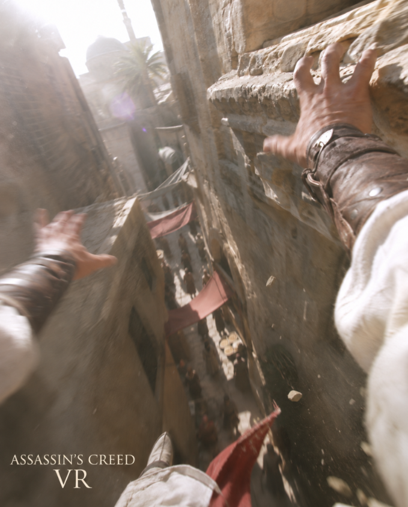
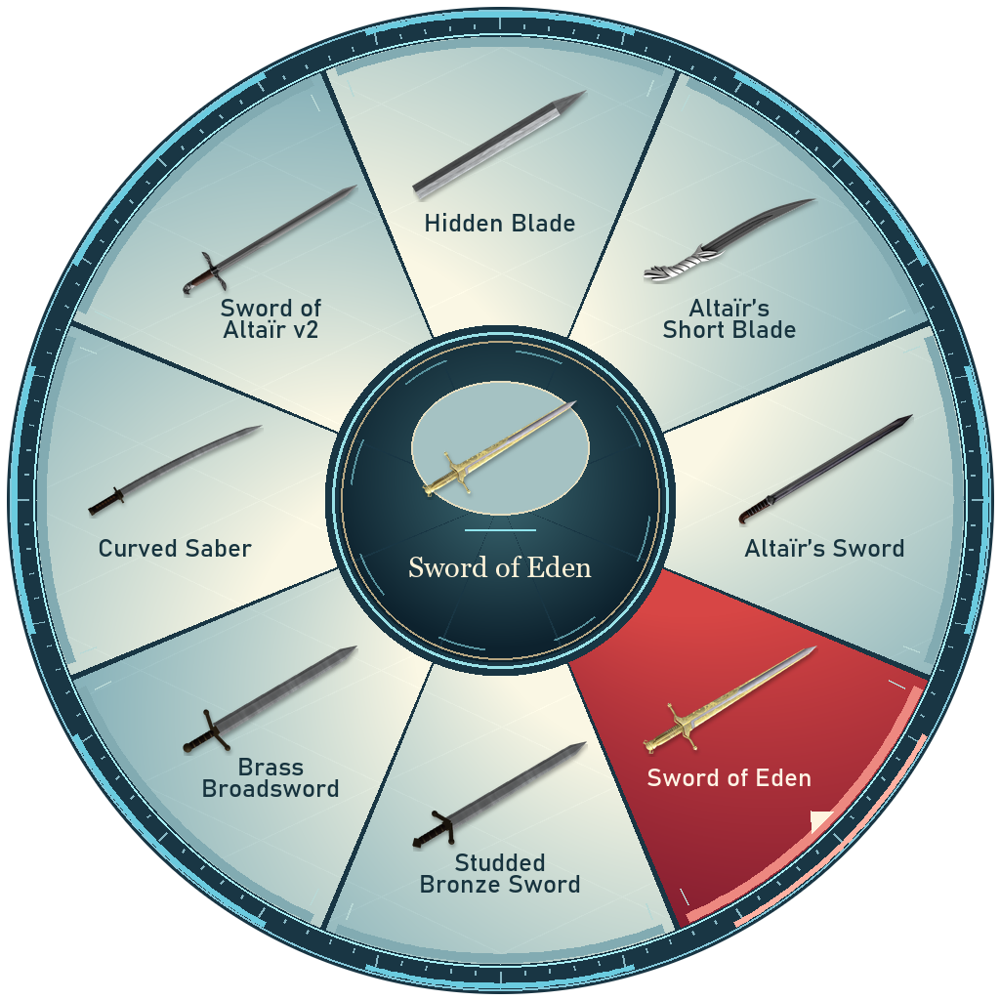

  

<h1 align="center">Assassin's Creed VR (2007)</h1>

  
  
  
  

<b>First-person VR · 6DoF head tracking · full motion controls for both hands · stereo OpenXR</b>

<b><a href="https://hngamers191.github.io/AC1-VR-MOD/">Open the site →</a></b>

---

Masyaf and Jerusalem in a headset. Tracked hands, a sword you swing yourself, climbing
with your own grip — running on the original game through OpenXR.

Become Altair in full immersive VR with this Assassin's Creed VR port. Wield the hidden
blade and Altair's sword in first person, and be an assassin in the Holy Land of Jerusalem.

## The Animus weapon wheel

Bring either hand to your chest and press its trigger. Move that controller’s thumbstick toward one of the eight pictured weapons, then release the trigger to draw your choice. The crimson sector marks your selection and the center shows a larger view. Click the right thumbstick to open VR settings separately.

Players have tested sword attacks and blocking with both the flat and the edge on headset. The illustrated wheel was also checked in both eyes in XR Sim.

## What the mod adds

- **Tracked hands and body** — your own hands in first person, with live fingers and a body that moves under you
- **Physical sword combat** — swing it yourself; hits land where the blade lands, blocks come from your guard
- **Climb with your grip** — squeeze a ledge, pull down, reach for the next hold with your free hand
- **Hidden blade** — flick your wrist to extend it, stealth kills from behind on anyone unaware
- **In-VR settings menu** — Combat, Blade, Comfort, Extras and Mods tabs, floating in front of you
- **Swappable swords** — Sword of Eden, Sword of Altair v2, Altair's Short Blade from your back, and more
- **Play as Desmond, in the modern day** *(coming next)* — step out of the Animus and walk the present-day sections in VR

## Install and launch

[Download AC VR V1.2 for Windows](https://github.com/Hngamers191/AC1-VR-MOD/releases/download/v1.2/AC-VR-V1.2.zip).

For the original **Assassin's Creed (2007)** on Steam for Windows. The base VR mod has
been tested on Meta Quest 3.

1. Install the original **Assassin's Creed (2007)** from Steam on Windows. Use
   **Manage → Browse local files** in Steam to open the game folder.
2. Extract the AC VR V1.2 ZIP. Copy the complete mod folder containing `RUN.bat`
   into the game folder, next to the game's `.exe`.
3. Connect your headset and start its PC OpenXR runtime. Open the mod folder and run
   `RUN.bat` each time you play.

In the headset, click the right thumbstick to open the settings menu.

## Test notes

Headfirst falls, sword throwing and procedural weather are in active testing.

## What changed in V1.2

- **Rendering and performance.** The DX10 build uses the native render scheduler and OpenXR stereo submission for gameplay. The headset tester reported smoother, stable play. The 87.3 FPS figure from the donor benchmark has not been verified for this release in the one-minute market test. Actual performance depends on the scene, headset settings and hardware.
- **Combat.** Sword and dagger contact, physical blocking and controller feedback carry through to first-person fights. The game handles the final hit and fall, and defeated characters leave the blade-contact list. In the headset test, more than a dozen guards completed their hurt and fall animations across consecutive fights.
- **Weapons and controls.** Draw the sword from your waist or Altaïr’s dagger from your back. The chest-trigger weapon wheel equips the selected weapon. Away from the chest, the right trigger flips the dagger around its hilt. The hidden blade follows the left wrist and gives feedback on extension and retraction. Armed movement and right-stick turning were adjusted for freer movement during fights.
- **Hands and traversal.** The first-person gloves cover the wrist opening, with the white sleeves removed. The hand-mounted map, health display, grabbing and tracked-hand climbing are included.
- **Settings and weather.** The VR settings include controls, comfort and mod options, credits and the in-headset changelog. Choose original game lighting or manually select day or night, with night lamps, weapon lighting and a separate rain toggle.
- **Campaign.** The public launcher opens the original campaign menu and uses your saves. The market test teleport is disabled. Memory Block 4 follows its normal Bureau checkpoint.

## Visual notes

The Animus loading room uses a shared image for both eyes. It can look flat in the headset, and the blue-cloud view can briefly appear during transitions. The requested continuous third-person stereo loading view remains unresolved. City gameplay uses stereo rendering. Nearby NPCs can occasionally flicker at the edge of the view. The lower cape is visible when looking down in first person.

## AC1 VR mod V1 changelog

- **V1.0.1:** Memory Block 4 starts inside the Assassin’s Bureau. Use your hands to climb out to the street.

- After returning from modern-day Desmond to Altaïr in the Animus, click the left stick to switch back to first person. Verified on headset.

- Open the weapon wheel by pressing the trigger at your chest. Use the stick to select a weapon and release the trigger to equip it.
- Draw Altaïr’s dagger from your back. Away from your chest, press the right trigger to reverse the blade while the hilt stays in your grip.
- Sword hits now let the game play the finishing reaction. A headset playthrough confirmed consistent reactions and falls across several guards in succession.
- Third-person NPCs retain their proportions at the edge of the headset view.

In first person, you can see the lower edge of Altaïr’s cape when you look down. The mod also includes hand and head collision with scenery.

## Known issues

- **Occasional NPC flicker in third person.** A character may briefly flicker as they pass through the edge of your view.
- **Delays during combat.** Fights with several guards can slow down for a few seconds.
  That is normal for this build and it settles once the fight ends.

Found something else? Message the authors — open an
[issue](https://github.com/Hngamers191/AC1-VR-MOD/issues), or get in touch with HNgamers
or MonsterDeadwood directly. Say what you were doing and what happened, and send the
newest folder from `cold_start\runs`; that folder is what makes a fault findable.

## Credits

**The VR mod** — HNgamers, MonsterDeadwood

**Sword models** — Vortix (Sword of Eden), Yuri (Sword of Altair v2),
Milacetious (Altair's Short Blade)

**The game** — Assassin's Creed, Altair and the original designs are Ubisoft's.

> Ask each model author for permission and credit them before sharing this mod publicly.

## First-person sword test candidate

Use the AC1VR DX10 collaborator test package dated 2026-11-17 as the base. With the game closed, back up the files listed in [the overlay](sword-candidate), then copy the contents of that folder into the mod folder beside its existing RUN.bat, preserving subdirectories. Run `RUN.bat --check` there before launching. For headset play, start the headset's OpenXR runtime and run `RUN.bat` without simulator arguments.

The XR Sim replay recorded ordinary blade damage, an intercepted guard attack and a lethal counter against the same guard. Both processes exited cleanly and the encounter permissions and saves were restored. Physical-headset timing and feel remain unverified for this candidate. [Replay measurements](candidate-source/guard-replay.json)

## Thank you

Thanks for checking out Assassin’s Creed in VR and for sharing what you find in the headset. If you’d like to support development, [H_ngamers is on Ko-fi](https://ko-fi.com/hngamers).
